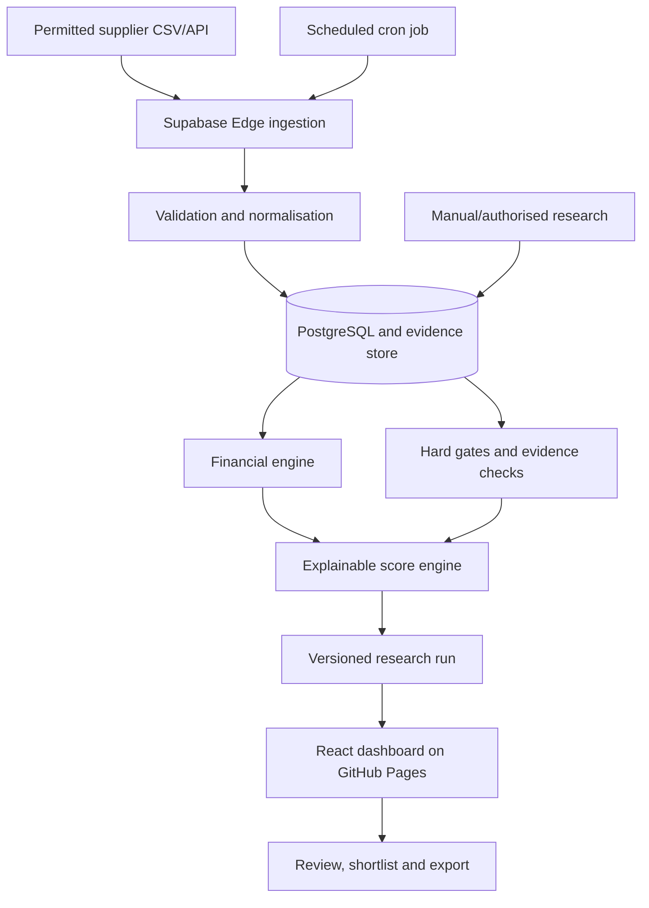

# UK eBay Product Research Intelligence — Master Codex Specification

**Project:** `ebay-uk-product-intelligence`  
**Document version:** 1.0 / 16 October 2026  
**Product owner:** private UK dropshipping research project for a two-person household  
**Audience:** OpenAI Codex / engineering agent / owner-reviewer  
**Status:** Implementation-ready requirements; NOT a claim that data integrations have been approved or built

> **Codex instruction:** This specification is the source of truth. Implement it in the numbered phases. Do not invent sales numbers, supplier commitments, live API credentials, or eBay permissions. Make the first phase runnable without paid services or external API keys by using clearly tagged DEMO fixtures. Ask for secrets only when the integration needs them. Do not implement scraping, automated buying, repricing, order fulfilment, or publishing eBay listings.

---

## 0. Executive summary and design decisions

Build a **mobile-friendly private research website** that repeatedly ingests permitted UK wholesale catalogue feeds; discovers and normalises products; filters out unsafe or low-value candidates; tracks research evidence; calculates realistic UK unit economics; assigns explainable 0–100 ratings **only when required evidence exists**; produces an auditable product ranking; and generates a 20 → 10 → 5 → 3 shortlist with reasons, approvals and exports.

The application must distinguish **lead**, **promising lead**, **economically viable**, **demand-validated**, and **approved to consider listing**. No stage implies actual future sales or marketplace permission to list.

**Hosting decision:** The source code and CI/CD live on **GitHub**. The browser application is statically hosted on **GitHub Pages**. Use **Supabase** (hosted PostgreSQL, Auth, Edge Functions, Storage, Cron) for secure authentication, database and backend jobs. GitHub Pages cannot run server-side applications or hide secrets. Initial cost target is £0 where free-plan limits permit; never assume all services will remain free. The Pages URL will ordinarily be `https://<owner>.github.io/ebay-uk-product-intelligence/`.

**Front end:** React 19, TypeScript strict, Vite, Tailwind CSS, shadcn/ui (Radix), Lucide icons, TanStack Query, TanStack Table, React Router (HashRouter initially to avoid GitHub Pages deep-link 404), React Hook Form + Zod, Recharts, date-fns.

**Backend:** Supabase PostgreSQL + RLS + Auth (email magic link/OTP), Supabase Edge Functions in TypeScript/Deno for privileged imports/jobs, Supabase Storage (private import buckets), Supabase Cron for periodic lightweight checks. Maintain a replaceable adapter interface for later changes of backend.

**Tests:** Vitest, Testing Library, Playwright, pgTAP/Supabase DB tests, Edge Function unit tests. GitHub Actions CI and Pages deployment.

**Boundary:** User requests **research and scored recommendations**, NOT an order-fulfilment engine or automatic listing bot. No eBay seller account OAuth or posting in MVP; no discussion about seller account conversion in the UI. Support a manually controlled listing-readiness review only. Use GBP and `Europe/London` display; record timestamps in UTC.

---

## 1. Business objective, audience and success criteria

### 1.1 User problem

Manual research across wholesale catalogues, eBay Sold Items, Product Research and competitor listings is slow, inconsistent and difficult to reproduce. Prior shortlists suffered from comparing different SKUs, treating asking prices as sold prices, unverified postage, and assigning recommendations without adequate sales evidence. The application must prevent those errors systematically.

### 1.2 Users and roles

- `owner`: user's wife, full access to research, supplier credentials, settings and approvals.
- `analyst`: an optional invited collaborator who researches products, adds notes and creates reports; cannot modify service secrets, supplier accounts or final approval unless granted explicitly.
- Start as a **single workspace**, with optional second member. Never store or ask for eBay password or banking credentials.
- Protect all business data with authentication, even though the frontend files are public on GitHub Pages.

### 1.3 Acceptance metrics (aspirational, not claims)

1. Import a permitted supplier CSV with 500 products; validate and preview without corrupting the database.
2. Automatically reject or flag unverified, high-risk, unavailable and negative-margin products.
3. Run reproducible deterministic ranking and show all numeric inputs, formulas and source timestamps.
4. Produce a human-reviewable shortlist showing **why each candidate passed or failed**.
5. Never display fabricated sales numbers, market shares, sell-through rates or supplier stock.
6. Refresh permitted supplier product data on schedule, and visibly mark stale/failed refreshes.
7. Export a dated XLSX/CSV report showing exact input source and calculation version.
8. Work on Android Chrome, iPhone Safari and desktop; good keyboard navigation.
9. Secrets never appear in frontend bundle, Git repository, exports or logs.
10. CI passes tests, linting, build and GitHub Pages deployment on default branch.

### 1.4 Non-goals and explicit exclusions

- No auto-publishing eBay listings, auto-ordering, auto-repricing, auto-tracking updates, retailer-to-customer arbitrage, or seller feedback automation.
- No invented eBay sold-data API. Do not claim eBay Browse API returns completed/sold transactions.
- No headless browser scraping of eBay, bypassing authentication, CAPTCHA circumvention, or use of questionable data resellers by default.
- No paid AI model dependency for MVP. Optional AI features must be explicitly enabled, limited to authorised supplier text, never eBay Content as model input unless authorised.
- No guarantee that a high rating equals profitable sales.

---

## 2. Compliance, rights, and feature flags (mandatory)

### 2.1 eBay policy distinction

eBay's dropshipping policy allows fulfilment directly from legitimate wholesale suppliers and disallows listing then buying from another **retailer or marketplace** to ship directly to the buyer. Supplier classifications are independently verified. Only suppliers with documented eligible fulfilment may reach approved status.

### 2.2 eBay developer-data restrictions

Official eBay Browse API exposes active listing discovery, not standard access to historical sold-item research. Marketplace Insights is limited-release. eBay's API License Agreement imposes specific restrictions on: deriving site/seller statistics without permission; using eBay Content to model suggested eBay prices; seller arbitrage; and AI training from eBay Content. Consequently:

- Ship `EBAY_API_ENABLED=false` initially.
- Ship `EBAY_MARKET_ANALYTICS_LICENSED=false` and `EBAY_PRICING_ANALYTICS_LICENSED=false` initially.
- Any eBay data adapter must state EXACTLY which API, scopes, fields, marketplace and contractual use case is authorised. No data may flow into prohibited analytics/pricing/AI modules without documented permission.
- eBay price analysis/competitor ranking based on API Content is **disabled by default**, even if Browse search technically succeeds; don't treat technical access as legal authority.
- Competitor evidence may be captured as user-authored research notes/links or via a specifically licensed provider whose rights expressly cover the intended private commercial research, storage, display, and derivative computations. Obtain licence review before enabling.
- Do not silently change restricted modes to scraping when an API fails.
- Retention and deletion of eBay-sourced information must follow the applicable agreement; keep provenance and delete on expiry/revocation.

### 2.3 Product and consumer safety

Each candidate requires risk categorisation. Block by default high-risk items: medical products, supplements, cosmetics, electrical mains, batteries, baby safety, children's toys, PPE, food, regulated chemicals, branded goods without authorisation, counterfeit-susceptible goods, controlled/prohibited products, high-value fragile or oversized shipping. An administrator can change screening rules with audit log; a high-risk block cannot be overridden solely by score. The system is decision support, not legal certification.

### 2.4 Quality and source provenance

Every non-demo metric requires `source_type`, `source_url_or_document`, `recorded_at`, `valid_as_of`, `captured_by`, `licence_basis` and, where applicable, a `source_record_id`. Display badges: `Verified supplier feed`, `User entered`, `Authorised provider`, `Estimated`, `Unverified`, `Stale`, `Demo`.

**Never treat seller asking prices as completed sales, cumulative sold counts as 30-day sales, similar products as identical SKUs, or supplier list price as verified landed cost.** If evidence is missing, output `NULL / Not verified` and `INSUFFICIENT_EVIDENCE`.

---

## 3. User journeys and product workflow

### Journey A: first-time setup

1. Owner opens GitHub Pages link, signs in via Supabase Auth magic link/OTP.
2. Onboarding chooses `United Kingdom`, `GBP`, default financial assumptions, maximum order-float budget, and risk thresholds.
3. Walkthrough shows DEMO fixtures distinctly (no live research data yet).
4. Owner imports permitted supplier CSV, maps column headers, reviews sample, accepts import.
5. Application validates rows, deduplicates suppliers/SKUs, stores versioned product offers.
6. Initial prefilter sorts to promising leads and requests missing shipping/invoice/stock information.

### Journey B: weekly automated product hunting

1. Weekly run starts by manual button or scheduled job.
2. Refresh authorised supplier feed(s); if unavailable, use saved approved recent snapshot but mark stale.
3. Normalise and categorise, deduplicate exact SKU/GTIN/variant, flag missing data.
4. Apply blocked categories/suppliers, min stock, delivery rules, maximum capital exposure and preliminary cost filters.
5. Generate screening `run_id`, show count at each funnel stage, and persist all rejection reasons.
6. For surviving items, calculate user-selected price scenarios **without deriving prices from restricted eBay API Content**.
7. Where licensed demand evidence exists, compute demand and competition sub-scores; otherwise place in `RESEARCH_NEEDED` and provide manual evidence checklist.
8. Return top-ranked verified candidates with 0–100 score, confidence, conditions and date; export report.
9. Human reviews, orders sample if sensible, documents supplier permission and delivery test, and manually approves/rejects. No automatic listing.

### Journey C: side-by-side compare

Select up to five products; compare specification, variant, supplier, true delivered cost, research evidence freshness, fees, profit scenario, cash tied up, category risks and approval status. Every metric has source tooltip.

### Journey D: scenario analysis

User edits hypothetical selling price, supplier shipping, fee policy, advertising share or expected return loss; app computes optimistic/base/stress profit and minimum profitable price. User may save scenario as versioned personal plan (not automated competitor-derived repricing).

### Journey E: supplier evaluation

Enter supplier details, documentation, fulfilment terms, shipping postcode/country, fulfilment times, returns fees, packaging branding, stock source and sample delivery test. Mark permission `PENDING`, `APPROVED`, `REJECTED` with source document link and reviewer name.

---

## 4. Pages and UX specification

Use a polished, restrained SaaS design with desktop sidebar, mobile bottom navigation, readable tables and responsive cards. Support light/dark themes, accessible contrast, empty states and optimistic UI only where safe. Currency display `en-GB GBP`; date display Europe/London.

### 4.1 Screens and routes

1. `/` Dashboard — KPIs: candidates imported, insufficient evidence, verified shortlist, blocked suppliers, last run, budget exposure; funnel 20→10→5→3 where meaningful; recent alerts.
2. `/products` Product Explorer — search, filters, category, supplier, availability, source freshness, evidence status, contribution, margin, rating, gating status; selection and bulk actions; pagination.
3. `/products/:id` Product Detail — supplier offer, specification, variants, sources, scenarios, historical snapshots, competition & demand evidence (when authorised), score-breakdown chart, risk checklist, approval history.
4. `/shortlist` Shortlist — ranking, comparison, saved lists, manual workflow stage, export.
5. `/research` Research Evidence — upload/import manual evidence, notes, exact SKU matching, authorised provider metadata; checklist of missing facts.
6. `/suppliers` Suppliers — data feeds, permission documents, last sync, reliability assessment, returns/shipping policies, approved status.
7. `/imports` Supplier Imports — drag/drop CSV, column map preview, validation errors and import history; sample template download.
8. `/runs` Research Runs — current status, per-stage counts, errors, source freshness, per-candidate rejection reasons; rerun.
9. `/profit` Profit Calculator — standalone what-if computation, base/optimistic/stress, capital exposure, configurable fee policies.
10. `/reports` Reports — dated ranked export CSV/XLSX; source coverage, data caveats; download link.
11. `/settings` Financial assumptions, risk rules, weights, scheduled scans, integrations, team, data retention.
12. `/login` Supabase Auth; `/onboarding` welcome; `/not-found` route fallback.

### 4.2 Product card requirements

Each product row/card shows image from licensed supplier, name, SKU, supplier, source freshness, target scenario price tagged MANUAL, landed supplier cost, modeled fees, contribution £, margin %, rating if eligible, confidence, status, stock, delivery days, and `Why this rating?` expand. It includes actions: Details / Compare / Add to research / Watchlist / Reject / Export. Don't expose buttons that have no working handler.

### 4.3 Dashboard visualisations

- Research pipeline funnel with actual run counts and reason filters.
- Rating distribution using only score-eligible candidates; unscored is separate.
- Margin vs evidence-confidence scatterplot.
- Supplier cost and freight share; product risk breakdown.
- Source freshness heatmap/alerts.
- Versioned score change chart for a product (never conflates scores under different model versions).

### 4.4 Trust UX

Show persistent label `Research assistant — not a guarantee of sales`. Use neutral categories `APPROVED_FOR_REVIEW`, `RESEARCH_NEEDED`, `FAILED_GATE`, `BLOCKED`, never celebratory 'guaranteed winner'. Every number must have currency/period/units and a source popover. If data is demo, display a full-width `DEMO DATA` strip, never a deceptive live-style badge.

---

## 5. Technology and architecture

### 5.1 Repository structure

```text
ebay-uk-product-intelligence/
  AGENTS.md
  README.md
  LICENSE                       # only if owner chooses open-source
  package.json
  pnpm-lock.yaml
  .gitignore
  .env.example
  .github/
    workflows/
      ci.yml
      deploy-pages.yml
      supabase-deploy.yml       # manual/controlled, not automatic until configured
  apps/
    web/
      index.html
      vite.config.ts
      src/
        main.tsx
        App.tsx
        routes/
        components/
          ui/                 # shadcn primitives
          charts/
          products/
          research/
        features/
          auth/
          dashboard/
          products/
          suppliers/
          imports/
          runs/
          profit/
          reports/
          settings/
        hooks/
        lib/
          supabase.ts
          query-client.ts
          currency.ts
        styles/
  packages/
    domain/
      src/
        models/
        schemas/
        money/
        fees/
        scoring/
        gates/
        matching/
        provenance/
    fixtures/
      products.demo.json
      suppliers.demo.json
      scan.demo.json
    connectors/
      src/
        types.ts
        csv-supplier.ts
        http-feed-supplier.ts
        ebay-active-listings.ts   # DISABLED by default / permission gated
        licensed-market-data.ts
  supabase/
    config.toml
    migrations/
    functions/
      _shared/
      import-supplier/
      start-research-run/
      process-research-batch/
      export-report/
      scheduled-refresh/
  tests/
    e2e/
    rls/
  docs/
    architecture.md
    data-sources.md
    methodology.md
    security.md
    deployments.md
    decisions/
```

**Note:** For GitHub Pages project-site path, configure Vite `base: '/ebay-uk-product-intelligence/'`, or use `VITE_BASE_PATH` from GitHub Actions. Use HashRouter or an explicit static SPA fallback; document the choice. Avoid direct Supabase service-role access from `apps/web`.

### 5.2 Component/data flow



### 5.3 Backend and execution policy

Keep calculation utilities pure and shared between client and Edge Functions. Server recomputes and verifies all persistence-sensitive outputs. Use batches (e.g., 50–100 products) with bounded concurrency, idempotent retries and scan cursor; do not run huge catalogue processing in a single Edge Function call (CPU and wall-time limits). Use database job status rows, `FOR UPDATE SKIP LOCKED` or equivalent safe claim mechanism for background work, plus timeouts and retries with exponential backoff.

### 5.4 Integrations adapter interface

```ts
export type EvidencePermission = 'approved' | 'manual_only' | 'pending' | 'blocked';
export interface DataSourceAdapter {
  id: string;
  kind: 'supplier_csv' | 'supplier_api' | 'manual_research' | 'licensed_market_data';
  capabilities: Array<'catalogue' | 'stock' | 'shipping' | 'sales_history' | 'active_offers'>;
  permission: EvidencePermission;
  fetchPage(input: { cursor?: string; limit: number }): Promise<{
    records: unknown[]; nextCursor?: string; fetchedAt: string;
  }>;
  validate(input: unknown): { valid: boolean; issues: string[] };
  normalize(input: unknown): NormalizedRecord;
}
```

No adapter may announce `sales_history` on the basis of eBay Browse search. Market-data adapters must have supplier/licence configuration, allowed derivatives, retention policy and tests.

---

## 6. Data contract and database design

Use PostgreSQL UUID PKs, created/updated UTC timestamptz, `workspace_id` on every tenant-scoped table, CHECK constraints, FK references, proper numeric precision for currency, and indexes on FK/status/source/updated_at. Prefer amounts as **integer minor units (pence)** in computation/storage with `NUMERIC` for percentage rate; never JavaScript floating money. Implement a tested Money type or currency minor-unit helpers. Standardise ISO currency `GBP` initially.

### 6.1 Tables, fields, indexes and relations

| Table | Important fields | Purpose |
|---|---|---|
| `workspaces` | `id`, `name`, `currency='GBP'`, `timezone`, `owner_user_id` | Tenant root |
| `workspace_members` | `workspace_id`, `user_id`, `role`, `joined_at` unique(ws,user) | Owner/analyst permissions |
| `suppliers` | `id`, `workspace_id`, `name`, `website_url`, `country`, `fulfilment_country`, `permission_status`, `permission_document_id`, `returns_policy_url`, `dispatch_days`, `sample_verified_at`, `reliability_score`, `reliability_notes`, `reviewed_by` | Supplier verification |
| `data_sources` | `id`, `workspace_id`, `supplier_id nullable`, `adapter_type`, `display_name`, `configuration_json`, `licence_status`, `allowed_uses`, `credentials_ref`, `last_synced_at`, `error` | Feed registration; NO raw secret |
| `source_documents` | `id`, `workspace_id`, `private_storage_path`, `mime_type`, `sha256`, `uploaded_by`, `captured_at` | Private source files |
| `import_batches` | `id`, `workspace_id`, `source_id`, `sha256`, `status`, `rows_seen`, `rows_ok`, `rows_rejected`, `error_summary`, `started_at`, `completed_at` | Auditable ingest |
| `import_row_errors` | `id`, `batch_id`, `row_number`, `field`, `error_code`, `message` | Reject details |
| `products` | `id`, `workspace_id`, `canonical_title`, `brand`, `gtin`, `mpn`, `category_code`, `variant_key`, `spec_json`, `risk_tier`, `compliance_status`, `image_url`, `status` | Normalised unique product |
| `supplier_offers` | `id`, `workspace_id`, `product_id`, `supplier_id`, `sku`, `currency`, `unit_cost_pence`, `unit_cost_tax_status`, `min_order_qty`, `shipping_pence nullable`, `handling_pence nullable`, `returns_fee_pence nullable`, `warehouse_country`, `stock_qty nullable`, `dispatch_days nullable`, `last_seen_at`, `source_id` | Actual supply options |
| `offer_snapshots` | `id`, `supplier_offer_id`, `captured_at`, `cost_pence`, `stock_qty`, `shipping_pence`, `raw_record_sha256`, `import_batch_id` | Historical supplier tracking |
| `research_evidence` | `id`, `workspace_id`, `product_id`, `evidence_kind`, `value_json`, `period_start`, `period_end`, `metric_unit`, `source_type`, `source_url`, `source_document_id`, `licence_basis`, `comparable_match`, `recorded_at`, `valid_as_of`, `captured_by`, `verified_by`, `verification_status`, `notes` | Typed demand/competition evidence |
| `comparable_products` | `id`, `workspace_id`, `product_id`, `comparison_key`, `title`, `brand`, `spec_json`, `matching_confidence`, `exact_variant_match`, `match_reason`, `source_id`, `allowed_use` | Prevent bad competitor matches |
| `fee_policies` | `id`, `workspace_id`, `marketplace='EBAY_GB'`, `seller_tax_profile`, `effective_from`, `effective_to nullable`, `schedule_json`, `source_url`, `verified_on` | Versioned category fees |
| `financial_assumptions` | `id`, `workspace_id`, `name`, `return_allowance_pct`, `ad_allowance_pct`, `listing_cost_pence`, `supplier_vat_treatment`, `fee_vat_treatment`, `budget_pence`, `min_profit_pence`, `min_margin_pct`, `created_by`, `version` | Owner choices |
| `price_scenarios` | `id`, `workspace_id`, `product_id`, `offer_id`, `scenario_type`, `manually_selected_price_pence`, `postage_revenue_pence`, `fee_policy_id`, `assumptions_id`, `profit_pence`, `margin_pct`, `cost_breakdown_json`, `calculation_version`, `created_at` | What-if economics |
| `research_runs` | `id`, `workspace_id`, `mode`, `status`, `config_snapshot_json`, `algorithm_version`, `started_at`, `completed_at`, `counts_json`, `error_json` | Reproducible scan |
| `run_candidates` | `id`, `research_run_id`, `product_id`, `supplier_offer_id`, `stage`, `rating nullable`, `confidence nullable`, `gate_status`, `reasons_json`, `scores_json`, `evidence_ids`, `scenario_id`, `rank nullable` unique(run,product,offer) | Per-run ranking |
| `screening_rules` | `id`, `workspace_id`, `rule_code`, `enabled`, `threshold_json`, `severity`, `effective_from`, `changed_by` | Versioned rules |
| `product_reviews` | `id`, `workspace_id`, `product_id`, `review_status`, `reviewed_by`, `reason`, `sample_order_tested`, `reviewed_at`, `next_review_at` | Manual final review |
| `watchlists` / `watchlist_items` | `id`, `workspace_id`, `name`; item `product_id`, `notes`, `created_at` | Saved tracking |
| `notifications` | `id`, `workspace_id`, `type`, `severity`, `message`, `link`, `read_at` | Alerts |
| `audit_events` | `id`, `workspace_id`, `actor_user_id`, `action`, `target_table`, `target_id`, `before_json`, `after_json`, `occurred_at` | Change audit |
| `export_jobs` | `id`, `workspace_id`, `research_run_id`, `format`, `status`, `file_storage_path`, `generated_at`, `expires_at` | Report generation |
| `job_queue` | `id`, `workspace_id`, `job_type`, `payload_json`, `status`, `attempts`, `next_run_at`, `leased_until`, `last_error`, `idempotency_key` | Robust background work |

### 6.2 Critical constraints

- `supplier_offers (workspace_id,supplier_id,sku)` unique, with variant-specific SKU; offer history in snapshots.
- `products` use product + variant identity; never combine different pack counts, dimensions, colours, wattages or models without exact GTIN/manufacturer evidence.
- All money values nonnegative except genuine refund adjustments; `stock_qty` nullable to preserve unknown, not zero.
- Research period always explicit (e.g., 2026-10-01 to 2026-10-16). Missing period => invalid for demand score.
- Supplier `permission_status` must be approved with evidence before final APPROVED_FOR_REVIEW.
- `data_sources.allowed_uses` is enforced in **server-side code** before metrics flow to downstream scoring, not merely displayed in UI.
- RLS on **all** tenant tables and Storage buckets. Users only see workspaces they belong to; analysts cannot modify settings, grants, feed secrets or owner-only review.
- Add appropriate trigram/full-text indexes only as needed after query plan evaluation.

### 6.3 Versioning and lineage

Store `algorithm_version`, `fee_policy_id`, `assumptions_id`, `source snapshot IDs`, `run_id`, `manual reviewer`, and data timestamps. A report export contains an `audit` tab for traceability. Updating fee rules creates new scenario calculations; do not silently rewrite historical reports.

---

## 7. Ingestion, cleaning and matching

### 7.1 Supplier import contract

Provide CSV + UTF-8/BOM support and optional JSON HTTP adapter. Required fields: `supplier_name`, `supplier_sku`, `title`, `unit_cost_gbp`, `currency`, `source_url`. Optional: `gtin`, `brand`, `mpn`, `description`, `category`, `variant`, `pack_qty`, `product_weight_kg`, `dimensions_cm`, `stock_qty`, `dispatch_days`, `shipping_cost_gbp`, `handling_cost_gbp`, `returns_fee_gbp`, `warehouse_country`, `image_url`, `tax_included`, `last_updated`, `dropshipping_permission_ref`.

Preview must map synonyms (`Price`, `WholesalePrice`, etc.), ask users to resolve ambiguity, and show errors before persisting. Reject malformed currency, negative cost, impossible dates, missing SKU, obviously dangerous links and duplicate conflicting SKU data. Avoid formula injection in CSV/XLSX exports by escaping cells starting `=`, `+`, `-`, `@` where needed.

### 7.2 Matching hierarchy

1. Exact supplier SKU for same supplier; same variant.
2. GTIN (validated checksum) + identical pack qty/variant; high confidence.
3. Brand + MPN + verified variant; medium-high confidence.
4. Title/spec text similarity can propose review candidates but **cannot automatically assert exact equivalence**.
5. Suppress cross-brand mismatches; compare pack size, model, dimensions, included accessories, materials and condition.
6. Store `match_method`, `match_confidence`, `reviewer_decision`, `why`.

Use deterministic normalized tokens/fuzzy heuristics first. Optional LLM-assisted product matching may process **supplier-owned/licensed content only** after permissions; result always needs a deterministic audit trail and manual review for low confidence.

### 7.3 Stock and shipping validation

- Missing shipping cost is `UNKNOWN`, **not £0**.
- Shipping is destination/weight/zone/quantity-specific; record basis and permitted coverage. Single supplier flat-rate delivery is a fallback assumption with citation, not verified per SKU.
- Respect minimum order quantities and whether suppliers support individual one-off direct-to-customer dispatch.
- Tax-inclusive vs tax-exclusive offer flag mandatory for financially verified stage.
- Supplier feed stock may be stale; show age and `stock_as_of`.

---

## 8. Screening pipeline, funnel and auditable 20→3 methodology

The tool should not pretend to use a fixed magic number. On a batch of 20 leads, it can return anywhere from 0 to 20 viable leads; **never force exactly three approvals**. It may display top three `FOR_RESEARCH` separately even if none is listing-ready.

### 8.1 Stage 0 — Discovery

Ingest 20–500 candidates from permitted supplier feeds and manual ideas. Record input batch, exact source and row IDs. Candidate `DISCOVERED`.

### 8.2 Stage 1 — Integrity and safety

Checks: valid SKU/GTIN, legitimate supplier, catalogue permission, non-prohibited product, verified country, clear variants, stock if supplied. Rejections with structured reasons. Candidate `CLEAN` / `BLOCKED` / `NEEDS_DATA`.

### 8.3 Stage 2 — Financial prefilter

Require delivered cost and user-selected price scenario before numeric pass. Calculate landed cost and platform fees; reject negative contribution, below minimum £4 contribution or below 20% contribution margin **under configured assumptions**. Since exact demand may be unavailable, financial pass is `POTENTIALLY_VIABLE`, not final approved. Missing supplier shipping goes `COST_UNKNOWN`, not optimistic pass.

### 8.4 Stage 3 — Demand and competition

Demand must be actual transactions, properly documented and authorised: relevant geography (UK), same product/pack, period (30d or 90d), sources, recent enough. Asking prices ≠ sales, cumulative counts ≠ sales per period, listing count ≠ demand. If no usable demand data, `RESEARCH_NEEDED` and omit demand/competition score. Proposed owner-adjustable starting heuristic: **≥15 comparable transactions in 30 days across ≥3 different sellers**, where reliable licensed evidence is available. It is not an eBay rule or validated universal threshold.

### 8.5 Stage 4 — Supplier/operational validation

Demand alone never overrides supplier failure. Check documented right to direct fulfilment, warehouse/dispatch location, tracked shipping, shipping SLA, returns address and refunds, availability, invoice, quality/sample evidence. `APPROVED_FOR_REVIEW` requires no critical missing values and human review. `LISTING_READY` is intentionally not an automated platform state.

### 8.6 Stage 5 — Ranked shortlist with full explanation

Rank only eligible, up-to-date candidates. Show score + confidence + contribution £ + available float impact + reason codes. Reports include **full universe** with rejection stage, not just top 3.

### 8.7 Evidence fields for each decision

`candidate_id`, `run_id`, `input_row_ids`, `source_urls`, `source_dates`, `stage_entered`, `stage_exited`, `gate_codes`, `gate_thresholds`, `observed_value`, `status`, `calculation_version`, `score_component_breakdown`, `human_override`, `reviewer`, `comment`.

---

## 9. Unit economics engine: formal model

### 9.1 Inputs

- User-chosen buyer-facing selling price (not auto-generated from restricted marketplace data).
- Shipping charged to buyer, if any.
- Supplier unit price, VAT treatment, UK postage, handling, packaging, import/customs if relevant, expected returns/refund cost.
- Applicable eBay UK fee category and time-versioned fee schedule: category-based percentage (possibly tiered), per-order fee, regulatory operating fee, listing fee, optional upgrades, any international/cross-border fee where relevant.
- VAT on applicable marketplace/service fees (with recoverability depending on seller VAT circumstances).
- Promotion or advertising allowance, return loss allowance, FX/payment fees where applicable.
- VAT registration status is a **configurable scenario**; default simplified UK non-VAT-registered. If UK VAT registered, apply output VAT and deductible input VAT via separate validated calculation path. Do not mix VAT-exclusive costs and VAT-inclusive revenues.
- Budget/float target: cash needed to pay suppliers before platform proceeds become available.

### 9.2 Definitions

For UK non-VAT-registered default scenario, all amounts in pence:

```text
buyer_revenue = selling_price + buyer_shipping_charge
landed_cost = supplier_unit_cost_including_nonrecoverable_VAT
            + supplier_shipping + supplier_handling + packaging
marketplace_fee_net = calculate_final_value_fee(buyer_revenue, category_fee_tiers)
                    + calculate_order_fee(buyer_revenue, per_order_rules)
                    + calculate_regulatory_fee(buyer_revenue)
                    + fixed_listing_fee_allocated
                    + optional_listing_upgrades
marketplace_fee_gross = marketplace_fee_net + nonrecoverable_VAT_on_fees
advertising_allowance = buyer_revenue * advertising_percentage
expected_returns_allowance = buyer_revenue * expected_loss_percentage
contribution = buyer_revenue - landed_cost - marketplace_fee_gross
               - advertising_allowance - expected_returns_allowance
               - other_variable_costs
contribution_margin_pct = 100 * contribution / buyer_revenue
break_even_price = smallest_user_selectable_price_at_which(contribution >= 0)
target_price = smallest_user_selectable_price_at_which(
  contribution >= min_profit AND contribution_margin_pct >= min_margin_pct
)
```

Calculate break-even/target using bounded monotone numeric search that invokes complete fee function (tiering, fixed charges and per-listing cost); round to pence and show as **user scenario**, not automated eBay price advice derived from eBay Content. Separate listing fee as per-unit/per-listing and GTC renewal risk. If one listing sells multiple quantities, cost allocation assumption must be visible.

### 9.3 Example with intentionally illustrative rates

Inputs: customer selling price £20, supplier £9, shipping £3, handling £0.40; **illustrative fee** 12% of total, fixed order fee £0.40, regulatory 0.35%, listing £0.30, VAT on these fees 20%; ads 2%, return loss 3%; buyer shipping £0, packaging £0, non-VAT-registered.

```text
Revenue                 £20.00
Supplier + delivery     -£12.40
12% category fee         -£2.40
Fixed order fee          -£0.40
0.35% regulatory         -£0.07
Listing fee              -£0.30
VAT on above fees        -£0.63  (round per model policy)
Ad allowance 2%          -£0.40
Returns allowance 3%     -£0.60
--------------------------------
Contribution              £2.80 (approx; precise rounding policy governs)
Margin                   14.0% (approx)
```

This example **fails** the default £4/20% screen despite a headline £8 supplier-to-selling-price gap. Rates are placeholders, not current eBay category advice. Fee policy must be checked against the official UK fee table and saved with `verified_on` and `effective_from` before real approvals.

### 9.4 Stress/working capital scenarios

- Base: advertised shipping confirmed, chosen ad/return assumptions.
- Stress: supplier shipping +20%, expected return cost +50%, selling price −10% (manually hypothetical), and GTC/listing renewal scenario.
- Optimistic: supplier negotiated quote (only if documented), no automatic price suggestion.
- Float exposure: `supplier_paid_per_order * max_concurrent_unsettled_orders` + reserve. Default planning cash pool £200–£500; demo assumes £350. User enters max spend; warn if product pair or order volume exceeds it.
- Product cannot be `APPROVED_FOR_REVIEW` if base scenario fails targets, and must display stress failure separately.

### 9.5 Precision and accounting

Use decimal arithmetic or integer pence everywhere. Explicit half-up or banker’s rounding policy (documented, tested); don't cast float to pence without controlled decimal parsing. Distinguish **contribution before overhead and income tax** from net profit. Returns allowance is not guaranteed; keep underlying assumption visible.

---

## 10. Scoring, confidence, hard gates

### 10.1 Scoring only after eligibility

A score without evidence looks precise but is meaningless. **If any required component is missing/stale/non-permitted, set rating to NULL**. Show `Data completeness X/Y`, `Confidence: Low/Medium/High` as separate metric. Do not substitute zeros for unknown demand. Product can have preliminary `financial_screen_score` but not overall `rating`.

### 10.2 Version 1 weighted score (100 points)

| Component | Maximum | Raw data | Illustrative subscore rule |
|---|---:|---|---|
| Profitability | 30 | contribution margin and absolute £ contribution | 50% min-max-normalised margin (10–35%), 50% min-max-normalised £ contribution (£0–£10) |
| Demand | 25 | authorised exact-product UK sales during 30d and seller spread | 70% min-max volume 0–50 units + 30% seller distribution 0–5 sellers |
| Competition | 20 | comparable active offers and sales distribution | proxy ratio `sold_30d / max(active_exact_offers,1)` scaled to owner-configured target, adjusted for incumbent concentration |
| Supplier | 15 | permission, delivery on-time test, stock freshness, return terms | checklist-driven numeric rubric, not invented rating |
| Risk | 10 | product safety, breakage, size, support, refund experience | rubric 100 low / 50 medium / 0 high, with critical block |

All min/max, formula version, thresholds and weights configurable by owner and snapshot in each run. The proxy competition metric is NOT eBay's official sell-through rate and must be labelled `screening proxy`, not converted to marketplace sell-through. Critical seller concentration requires authorised evidence. Avoid auto-applying competition scores where licensed data is unavailable.

```ts
score100 = round(
  0.30 * profitability0to100 +
  0.25 * demand0to100 +
  0.20 * competition0to100 +
  0.15 * supplier0to100 +
  0.10 * risk0to100
);
```

Rating bands: 80–100 `HIGH_RESEARCH_PRIORITY`; 65–79 `REVIEW`; <65 `LOW_PRIORITY`. These are **ranking labels**, NOT approval states or predictive probabilities.

### 10.3 Hard gates (can't be outweighed by rating)

- `supplier_permission_documented=true`
- `source/licence allows this use=true`
- `landed_cost_complete=true`
- `exact_variant_identity_valid=true`
- `product_safety_review_complete=true` and non-blocked
- `base_contribution >= min_profit` (default £4)
- `base_contribution_margin >= min_margin` (default 20%)
- `stock_recent_enough=true` and minimum availability where verified
- `delivery_arrangement_verified=true`
- `demand_evidence_recent_and_sufficient=true` (to award demand-based rating/approved status)
- `returns_path_verified=true`

Each failure is a typed code and readable message. A product can be scored and STILL fail a safety hard gate; UI must show block prominently and never recommend listing.

### 10.4 Evidence confidence (separate from score)

Example rubric, adjustable:

- Freshness 0–30: demand ≤14 days, supplier cost/stock ≤7 days;
- Completeness 0–30: all economic and supply/demand metrics present;
- Identity matching 0–20: GTIN/MPN/verified variant;
- Independent corroboration 0–20: more than one acceptable evidence source with no conflicting data.

Low confidence if <50, medium 50–79, high ≥80. If data has a source prohibited for intended use, confidence cannot make it eligible.

### 10.5 Explanation contract

Every rating returns `component`, `weight`, `raw_metric`, `unit`, `normalisation`, `score`, `data_source`, `valid_as_of`, `limitations`. Example: `Profit 24/30 because margin 24%, £5.10 contribution; 30-day demand score withheld because no authorised sales record.`

---

## 11. Automated jobs, alerts and rate control

### 11.1 Jobs

- Nightly/weekly supplier feed refresh **only for feeds with explicit permission**.
- Weekly screening batch at a configurable local time (default Wednesday 09:15 Europe/London).
- Daily stale stock/cost warning for shortlisted products if permitted.
- Optional weekly digest within dashboard; email alerts only if service configured.
- Manual `Run now` triggers with per-workspace lock and job status, not duplicate concurrent runs.

Use Supabase Cron for DB-backed jobs; optionally GitHub Actions `workflow_dispatch` for operator-triggered orchestration and Pages deployment. GitHub scheduled Actions can be delayed or dropped; do not rely on exact-time delivery. Avoid setting external API keys in front-end environment variables.

### 11.2 Job guarantees

Idempotency key `(workspace_id, source_id, catalogue_snapshot_date, run_type)`; retries ≤3 with jitter; 429 exponential backoff; circuit breaker after supplier errors; skip disabled sources; timeouts; separate `PARTIAL_SUCCESS`, `FAILED`, `COMPLETED`; record run and per-product status; alert stale sources and show partial results instead of fabricating freshness.

### 11.3 Guardrails/cost controls

Set configurable API request cap/day, max products per run, file size limit, monthly processing budget, import size, concurrency and per-source retention. Stop on quota violation. No unlimited third-party paid requests. Optional 'estimated API spend' field if provider rates documented.

---

## 12. Public/backend API design (first party)

Frontend reads its own tables via RLS-protected Supabase client and invokes authenticated Edge Functions for writes/research actions. All privileged functions verify JWT, membership, input schemas and throttling; scheduled functions require secret auth. Do not accept arbitrary workspace IDs without authorisation.

| Operation | Method / function | Request | Result |
|---|---|---|---|
| Import preview | `POST /functions/v1/import-supplier?mode=preview` | CSV reference, column mapping | Sample rows, schema errors, warnings |
| Import commit | `POST /functions/v1/import-supplier?mode=commit` | signed storage path + mapping + idempotency | Batch ID, counts |
| Research start | `POST /functions/v1/start-research-run` | settings version, mode, source IDs | run ID + queued |
| Batch processor | `POST /functions/v1/process-research-batch` | internal job token | processed count |
| Scenario evaluate | pure package + validated Edge save | inputs and policy ID | profit, margin, breakdown, gates |
| Evidence add | RLS DB insert or authenticated function | typed evidence plus provenance | evidence ID |
| Supplier review | privileged update function | supplier ID, decision, document | audit event |
| Export | `POST /functions/v1/export-report` | run ID, formats | signed private file URL |
| Scheduled refresh | `/functions/v1/scheduled-refresh` | internal cron secret | queued jobs |

Use typed `zod` schemas at boundaries, generated Supabase DB types, consistent error format `{code,message,details,request_id}`. Paginate and limit all list queries; avoid client loading thousands of records at once.

---

## 13. Reports and exports

Export CSV with columns: scan ID/date/time, algorithm version, product/SKU/variant, supplier and permission, supplier price, shipping, handling, landed cost, scenario price, all fee components, contribution profit, margin, demand period/count/source, competition proxy/source, supplier risk, evidence confidence, overall rating/null, hard-gate status, all reasons, document URL, age of observations, reviewer decision.

Export XLSX (when implemented) with tabs: `Overview`, `Ranked`, `All Candidates`, `Financial Breakdown`, `Evidence Log`, `Rejected and Why`, `Assumptions and Policy Versions`, `Data Dictionary`. Escape cells to prevent formula injection. Reports are private, short-lived signed downloads; do not publish to public GitHub Pages assets.

At minimum deliver CSV in MVP; XLSX may follow in Phase 4.

---

## 14. Security and privacy

1. GitHub Pages is PUBLIC; never embed supplier secret, Supabase service-role or API credential in JavaScript.
2. Browser receives only public Supabase URL and publishable/anon key; DB grants + **RLS** restrict all business content.
3. Store supplier credentials only in Supabase Edge secrets or an appropriate encrypted vault; `data_sources` stores non-sensitive connector reference.
4. Auth: invite-only sign-in/magic link; no anonymous application data. Configure allowed origins/callbacks for GitHub Pages URL, current custom domain and localhost.
5. Edge Functions validate authentication/role independently; scheduled endpoints use secret or signed cron mechanism.
6. Secure uploads: storage bucket private, MIME allow-list (CSV, JSON, PDF for supplier evidence), size ≤10MB initially, virus/security considerations, signed URLs.
7. Protection: per-user rate limits, input sanitisation, URL allow-list and SSRF prevention for HTTP supplier feed connectors, CORS restricted to approved origins, CSRF considerations, safe error messages.
8. Logs never contain credential values, email magic links, full private documents, bank data or unnecessary personal data.
9. Audit owner/analyst changes; disable destructive bulk edits or require confirmation; support export/delete of workspace data.
10. Implement least-privilege SQL grants + RLS tests for `anon`, owner, analyst, unrelated account, and scheduled internal jobs.
11. Dependency scanning, branch protection, minimal third-party integrations; no eBay credentials.
12. Supplier images/content must be licensed or owner-approved. No hotlinking of media where supplier prohibits it.

---

## 15. GitHub Pages deployment / environments

### 15.1 Environments

- Local: `pnpm dev`, Supabase local stack (Docker) OR documented cloud development project; DEMO mode without secrets.
- Staging: optional separate Supabase project, branch deployment if feasible.
- Production: GitHub Pages project site + Supabase production.

### 15.2 Required deployment files

- `.github/workflows/ci.yml`: install pnpm, lint, typecheck, test, build; Playwright optional on PR.
- `.github/workflows/deploy-pages.yml`: triggers on main after passing checks; `actions/configure-pages`, `actions/upload-pages-artifact`, `actions/deploy-pages`; OIDC/id-token permission.
- Vite `base` from repo name; output `apps/web/dist`.
- `.env.example`: only `VITE_SUPABASE_URL`, `VITE_SUPABASE_PUBLISHABLE_KEY`, `VITE_APP_MODE`, `VITE_BASE_PATH` (safe publishable values). Real service secrets must NOT use VITE prefix.
- `supabase/migrations/*.sql`: up/down or rollback documentation, RLS policies, seed fixtures kept separate.
- `docs/deployments.md`: create GitHub repo, Supabase project, set auth redirect, set GitHub variables, initialise migrations, enable GitHub Pages Actions, visit URL, verify login and data isolation.

### 15.3 Important GitHub behaviour

GitHub Pages cannot execute Python/Node backends; it serves static JS/CSS/HTML. Public site assets are exposed to anyone regardless of sign-in. GitHub Free Pages generally requires a public repository. Do not commit sensitive source data even if repository is private. If preserving fully private app code is mandatory and GitHub Free prevents desired Pages deployment, switch **deployment target** to Cloudflare Pages or Vercel connected to a private GitHub repo after explicit user choice; do not silently change hosting in phase 1.

---

## 16. Testing and acceptance cases

### 16.1 Financial tests (must implement exact numeric expectations)

- Delivery `null` → margin/approval cannot be treated as verified.
- VAT included/excluded supplier quotes produce different economics as expected.
- Fee category tier boundaries, order fee thresholds and regulatory fee apply once/at documented bases.
- Calculate pence without IEEE-754 drift; verify £19.99 × percentage rules and rounding.
- Profit threshold £4 and margin 20% gates both required (AND).
- Stress scenario turns weak margins negative and shows warning.
- Multiple SKU or quantity allocation costs correctly; GTC renewal charge scenario.
- Supplier offer price change versioned; old reports unchanged.

### 16.2 Data/evidence tests

- Asking price cannot become sold price.
- Cumulative sold cannot become 30d quantity without dated evidence.
- Different pack counts don't merge.
- Missing demand => overall rating `null` not zero or 85.
- License-blocked source never flows into demand/price model.
- Stale stock and stale sales block approval.
- A score of 90 + unverified supplier permission => blocked.
- An import of duplicate supplier SKU is idempotent.
- Failed import rolls back only affected transaction/batch and produces row-level errors.

### 16.3 Security tests

- Anonymous cannot select private tables.
- Owner of workspace A cannot read/write workspace B.
- Analyst cannot alter owner fee policy or supplier credentials.
- Signed exported report expires.
- Arbitrary URLs do not get fetched unless an approved supplier feed URL; prevent local/internal IP SSRF.
- No private credentials in built `dist/` or logs.

### 16.4 End-to-end demo user story

1. Log in as demo user under local dev setup.
2. Import 20 clearly fake/unverified leads.
3. Explore all 20 and inspect missing data.
4. Fill shipping and choose scenario price for a demo product.
5. See profit recalculated and understand why no final rating exists without demand evidence.
6. Add mock **DEMO-only** authorised sales evidence; see rating and component breakdown.
7. Mark supplier permission `APPROVED` with fixture document; inspect gates.
8. Run weekly scan and get report with rejection reasons.
9. Build and deploy to GitHub Pages successfully.

### 16.5 Definition of done

Every feature must have UI, backend storage where relevant, schema validation, tests, loading/empty/error states, provenance, permission checks, docs and a brief change log. No placeholder button is 'done'.

---

## 17. Stepwise execution plan for Codex

### Phase 0 — Research, contracts and scaffold (required first)

Deliver architecture decision record; install framework; set up pnpm workspace; create Vitest/Playwright; GitHub workflows; deterministic demo fixtures; README and AGENTS. No credentials needed. Site displays usable demo dashboard and explicit DEMO banner.

### Phase 1 — Runnable website on GitHub Pages

Implement login shell, responsive navigation, dashboard, product table, filter/search/sort, details, compare (≤5), mock research run and calculator. All calculations from `packages/domain` with tested fixtures. GitHub Pages deploy works independently of Supabase availability in DEMO mode.

**Acceptance:** `pnpm install && pnpm lint && pnpm typecheck && pnpm test && pnpm build` succeeds; GitHub Pages action deploys; mobile smoke test passes.

### Phase 2 — Secure database and manual research

Supabase migrations + Auth + RLS; owner+analyst; private user workspace; CSV import preview/commit; source documents; manual evidence entry; versioned fee assumptions; persistent products and review actions.

**Acceptance:** multiple users isolated in RLS tests, persistence after refresh, no secrets in bundle, 500 row import works.

### Phase 3 — Scoring and supplier automation

Connector framework with authenticated supplier CSV or permitted API; scheduled incremental ingestion, stock/cost tracking; hard gates; explainable rating and confidence; background jobs; stale alerts and clear failure handling.

**Acceptance:** repeatable run with source/snapshot provenance; 0 ratings where evidence absent; gate reasons deterministic.

### Phase 4 — Reports and operational quality

Full CSV/XLSX audits, job monitoring, rich charts, evidence/license admin, tests, observability and performance. Optional email digest via configured provider, no paid provider required by default.

### Phase 5 — Authorised market research integration ONLY

Perform separate licence review. Add active listing discovery, market/transactions and competitor insight adapters **only for precise permitted uses**, disabled by default and guarded by permissions/tests. If approval cannot be obtained, retain manual research and source-specific third-party licensed exports. Do not hide limitations.

### Phase 6 — Optional future improvements

Supplier-score calibration based on real observed dispatch/return outcomes, matching suggestions on supplier text, larger batch orchestration, supplier diversification, product risk documentation, per-category models. Listing/ordering integrations **outside scope until separately authorised**.

---

## 18. Seed reference products and honesty labels

Load historical 20-product audit only as `UNVERIFIED_LEAD`, no stock/sales verified, and no final ratings. Historical prices are illustrative advertised figures observed in prior research and may have changed. The CSV included in this Codex package supplies the historical lead names and prices; it is **not a live supplier feed**. Do not present its quantities as verified sell-through.

Original preliminary three investigation leads: (i) 58-piece ratchet screwdriver set, (ii) three-piece white wicker storage baskets, (iii) 3-in-1 window squeegee. Subsequent checks identified substantial price competition or shipping uncertainty, so **zero original leads were approved to list**. Preserve these as a cautionary unit-test/data-quality scenario, not a positive training example.

---

## 19. Future cost assumptions and operations

- Frontend: GitHub Pages, generally no hosting charge within account plan/resource limits.
- Auth/backend/DB: Supabase free plan subject to project/resource/idle/quotas; production may require paid plan.
- Scheduling: Supabase Cron if available; review quotas; GitHub Actions execution availability not guaranteed.
- Supplier data: permissions/API integrations may require paid supplier subscription or business agreement.
- Authorised sold data: not assumed free or accessible.
- Optional emails/storage/domain: not included by default.
- Suggested internal budget cap for tooling during early store testing: £0–£10/month unless owner opts in. This is a planning suggestion, not a quoted vendor fee.
- Do not expose users to unexpected pay-per-request charges; alerts and hard monthly cap.

Monitor: scan completion rates, successful import %, stale products count, unverified data %, time to research each item, false-positive match rate, count of approved-for-review products, average modelled contribution, supplier failures, web performance and running cost.

---

## 20. External references (review again before coding restricted features)

1. GitHub Pages is static hosting, including GitHub Actions deployment: https://docs.github.com/en/pages/getting-started-with-github-pages/what-is-github-pages
2. GitHub Pages security/visibility: https://docs.github.com/en/pages/getting-started-with-github-pages/creating-a-github-pages-site
3. Supabase Auth/RLS: https://supabase.com/docs/guides/database/postgres/row-level-security
4. Supabase Functions: https://supabase.com/docs/guides/functions
5. Supabase Cron: https://supabase.com/docs/guides/cron
6. eBay Dropshipping policy: https://www.ebay.co.uk/help/posting-items/selling/setting-postage-options/drop-shipping?id=4176
7. eBay Business selling fees (UK; versioned, do not hard-code): https://www.ebay.co.uk/help/selling/fees-credits-invoices/store-selling-fees?id=4809
8. eBay Browse API: https://developer.ebay.com/develop/api/buy/browse_api
9. eBay Marketplace Insights (restricted) overview: https://developer.ebay.com/develop/get-started/get-started-on-a-buying-application
10. eBay API License Agreement (critical): https://developer.ebay.com/join/api-license-agreement
11. GitHub Actions schedule limitations: https://docs.github.com/en/actions/how-tos/troubleshoot-workflows

---

## 21. Codex operating instructions

1. Read this file + `AGENTS.md` + `IMPLEMENTATION_PLAN.md` before coding.
2. Start with Phase 0 and 1. Never claim the whole end-to-end market data system works until live permitted sources are connected.
3. Create one milestone-sized PR/commit at a time, each with test evidence and screenshots where possible.
4. Do not ask questions unless blocked by a truly required external decision/credential; choose documented reasonable UI defaults.
5. Use strict TypeScript, avoid `any`, validate input boundaries with Zod, keep functions small and pure.
6. Use consistent money units (integer pence) and test every fee formula.
7. Implement an unambiguous DEMO mode with seeded fake evidence; data provenance always visible.
8. No scraping or workaround when eBay API access or permissions are absent.
9. Do not include live eBay seller account integration, listing actions or supplier payment automation.
10. Before each milestone ends, report: files modified; features working; tests run; deployment result; remaining known blockers; next action.

**First Codex deliverable:** A React/Vite/GitHub Pages site with mocked 20-lead funnel, product explorer, detailed cost calculator, honest evidence states and reproducible tests. Everything else comes in later milestones.
