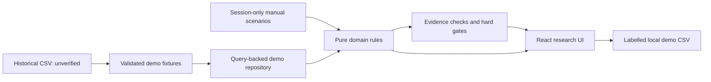

# Architecture and P0/P1 boundary

The first delivery is a static React 19 application with deterministic demo data and pure TypeScript business rules. It runs without API credentials, network data feeds or a Supabase project. GitHub Pages serves the generated HTML/JavaScript/CSS at a repository path; React Router HashRouter handles client-side routes without a server fallback.

| Workspace | Responsibility |
| --- | --- |
| `apps/web` | React/Vite/Tailwind UI, accessible controls, TanStack Query/Table, Recharts, navigation and local demo interactions. |
| `packages/domain` | Validated data contracts, integer-pence money, versioned fee/scenario calculation, evidence checks, hard gates, explainable scores and reporting rules. No React dependency. |
| `packages/fixtures` | The supplied 20 historical leads, preserved as unverified references, and separate conspicuously synthetic demonstration evidence. No private feed or live metric. |
| `packages/connectors` | Source capability/permission boundary and fail-closed disabled marketplace integration definitions. No scraping or external supplier fetch. |
| `.github/workflows` | Locked dependency install, lint/types/tests/build, static artifact upload and GitHub Pages deployment. |

Every seed lead begins with incomplete economic/supplier/demand evidence. Unknown values remain `null`; scenario inputs do not change source verification. A separate synthetic example can demonstrate the rating rubric without promoting a seed product. Hard gates remain independent from an attractive score.

P0/P1 UI state is local to the browser. Research/scenario edits are session-only. Any browser-stored theme or selection preference contains demo identifiers only and is not a secure data store. The login route explains the demo boundary; it is not an authentication implementation. Remote loading/error/empty states exist at the data adapter/UI boundary even while the default adapter is deterministic.

Future Supabase architecture is reserved rather than deployed: Auth, tenant-scoped PostgreSQL/Storage with RLS, authenticated Edge Functions and Cron-backed jobs. Server code must repeat persistence-sensitive financial and permission validation, and must not trust a client-calculated rating. Supplier imports, document uploads and private persistence are later milestones. No schema migrations or production credentials are required here.

See [decision 0001](decisions/0001-static-demo-and-pages.md), [methodology](methodology.md), [data sources](data-sources.md) and [security](security.md).

